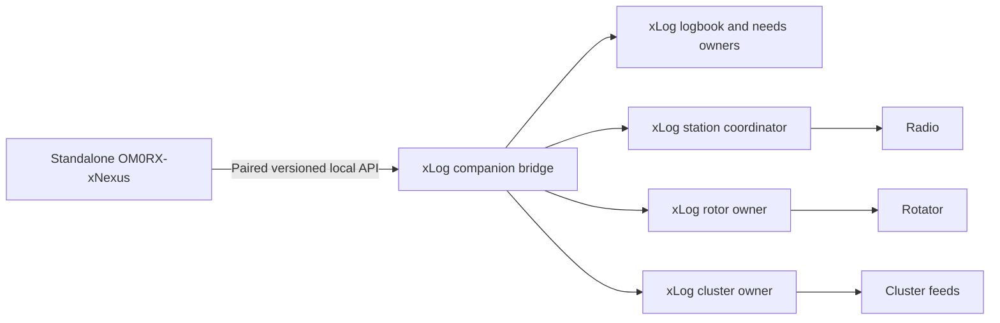

# OM0RX-xNexus delivery plan

Owner: OM0RX. Created 14 November 2026. Status: integrated source in development;
**not a qualified integrated station application**. This is the maintained backlog,
not a claim that future milestones are implemented.

## Product decision

Keep Nexus as a separate desktop application, with its own installer, settings,
window layouts and process. In xLog-connected mode, xLog owns the logbook,
station connections, rotator, cluster, credentials and authoritative need status.
xNexus must preserve the **original Nexus operating interface** with xLog services
underneath, including its operating views and decoding/modem workflow. The user
reaffirmed this requirement on 15 November 2026: the separate companion dashboard
is diagnostic scaffolding, not the intended product UI. Receive/needs candidate
`.5` is retained for internal testing only and will not be installed as the
user-facing replacement. TX is required and remains unfinished implementation.
No direct database sharing or second hardware owner is permitted.

An xLog outage leaves xNexus open with explicitly stale observations and disabled
actions. It must never fall back to native hardware, its own logbook, or a fresh
cluster connection. Independent operation, if retained, requires an explicit
mode selection and restart into a separate profile; it is not outage recovery.

## Evidence and feasibility

Source pins: Nexus `c88740a94172b3e78ae587d62bd0a54394d1e85f`, advertised
version 1.24.0; xLog `66df0feb443f5cf097a377383e0ee51c1346aa86` at inspection.
xLog's ongoing startup work was preserved in LiveReferenceMethods.swift, its
tests, and prototype/src-tauri/src/worker.rs. The “xlog work” chat confirmed
that current host/worker RPC is private, not an external API.

| Area | Existing source | Reuse / remaining work |
|---|---|---|
| Desktop | Nexus ui/, src-tauri/ | React/Tauri shell, separate from xLog |
| Needs/propagation | crates/propagation/src/{engine,awards,spot,pounce}.rs | Preserve propagation evidence; authoritative worked/confirmed facts come from xLog |
| External-client precedent | src-tauri/src/client_mode.rs, command_dispatch.rs | Existing no-local-station launch branch is a useful pattern, not an xLog-compatible protocol |
| xLog CAT | LiveStationSession.swift station_cat_servers; EmbeddedCATServers | Existing rigctld-compatible endpoint, but capability and session admission still required |
| Log classification | XClusterIntegrationCore/ClusterClassificationIndex.swift | Reuse xLog's entity corrections, history and confirmation rules |
| Log/needs RPC | LiveLogbookMethods.swift, LiveOpportunitiesMethods.swift | Adapt selected owner methods; do not expose generic RPC |
| Cluster | LiveClusterMethods.swift cluster_snapshot | Export bounded classified observations, preserve source and age |
| Rotor | LiveRotorSession.swift | Export observation first, owner-mediated commands later |
| Self-update | tauri.conf.json; lib.rs stable and beta update routes | Must isolate all update routes, signing keys and release workflows before packaging |

Nexus's NOTICE declares GPL-3.0-only and documents its WSJT-X lineage. Preserve
COPYING, NOTICE, per-file attribution and corresponding source. This fork is
initially private development. Public binary distribution requires a complete
license/dependency/model audit and corresponding-source delivery; separate-process
integration does not by itself settle all licensing questions. Do not copy xLog
implementation into Nexus merely because its API exposes the same facts.

## Architecture and ownership

The bridge is an opt-in service in the existing xLog process, not another worker
started against its live profile. Bind only loopback in v1. A native client pairs
through xLog with a revocable scoped token; no browser CORS, Origin-bearing calls,
redirects, proxy inheritance or generic method dispatch. Future LAN operation is
a different authenticated TLS design, not a switch to 0.0.0.0.

Hello advertises protocol, capabilities, server instance and workspace. Every
snapshot/command carries that identity. Workspace switch, restart, incompatible
protocol, stale data or sequence loss invalidates cached authority. Owner deadlines,
bounded response sizes and bounded queues protect station work from a slow client.
All command receipts distinguish accepted, applied and observed. No automatic
retry of a mutation whose outcome is uncertain.

## Work breakdown, dependencies and exit gates

Estimates are engineering effort, not delivery promises. Execution uses one
integration lead and three isolated agents for desktop, xLog bridge and release.
The existing xLog owner controls its canonical release/installation boundary.
Budget approximately 25–45 engineering days through a tested receive/control beta;
digital TX/audio and platform release work add 15–30 days, depending on findings.

| ID | Deliverable / owner | Depends | Effort | Exit evidence |
|---|---|---|---|---|
| M0 | Repository, upstream pin, ownership map, backlog / xNexus | none | 1–2d | Full history, private origin, fetch-only upstream, source/license inventory |
| M1a | Versioned read-only contract and tested native client / xNexus | M0 | 2–3d | Synthetic loopback tests: auth, identity, malformed data, stale/gap/reconnect, limits |
| M1b | Opt-in paired bridge in canonical xLog / xlog work | M1a + startup fix | 3–5d | Existing owners only; token revocation; same workspace; no station reconnect; no worker timeout regression |
| M2 | Original Nexus operating UI over xLog-connected services / xNexus | M1b | 4–6d | Preserve original cockpit/workflow rather than substitute the diagnostic dashboard; no competing Engine/device/log/cluster/upload owner; visible connection age; real paired snapshots |
| M3 | Needed board, awards/history and cluster / both | M2 | 4–7d | Edited/deleted/imported/confirmed QSOs update badges; exact mode vs award family; source evidence retained |
| M4 | Tune/select/rotator through xLog / both | M3 | 4–7d | Explicit action; correct radio; frequency/mode/split validation; limits; stop priority; observed receipt |
| M5 | QSO create/update outbox / both | M3 | 4–7d | Durable idempotency; crash after accept; duplicate replay; edit conflict; workspace switch; only xLog uploads |
| M6 | Decode/audio and transmit integration / both | M4,M5 | 10–20d | Audio ownership decided; RX verified; independent Stop/watchdog; TX disabled until explicit supervised qualification |
| M7 | Windows beta packaging + maintenance / xNexus | M2–M5 | 3–5d | Distinct identity/data/update channel; source receipt; isolated GUI; fake-hardware E2E; uninstall preserves xLog |
| M8 | macOS/Linux, signed releases / xNexus | M7 | 5–10d | Platform builds, native lifecycle tests, license assets and source archives |

M7 receive/control beta deliberately excludes unqualified transmission. Full product
completion includes M6 and M8; the bootstrap does not meet those gates.

M6's remaining transmit boundary is recorded in the
[owner-reviewed TX design draft](TX_DESIGN_DRAFT.md). The isolated
[pure period-preparation module](../../integrations/xlog-tx-prepare/VALIDATION.md)
now has focused reference/boundary tests, but remains unwired. The owner state
machine, scheduler, release path and sequencer are not complete or enabled;
offline implementation and supervised station acceptance remain separate gates.

### Next independent software slices

Checkpoint: 15 November 2026, after the integrated receive/needs source checks
and [internal-only `.5` Windows build/audit/retention](WINDOWS_BUILD_1.24.1-xlog.5.md).
Installed xNexus remains `.4`; xLog owner `.31` installation is a separate
checkpoint, not paired live qualification. The highest product priority is M2:
preserve the original Nexus interface and route its services through xLog.
Source checkpoint `ceb0ef61b` now mounts the actual original Nexus operating
window as the production xLog entry. Its nullable owner model, original panes,
shared full-count history reader, receive controls and real waterfall passed
focused tests, integrated TypeScript and three-viewport/six-layout browser checks.
The production bundle graph proves the original host is included. The subsequent
`21249e7c7` adds a tested, still-unwired rotor observation helper. Exact evidence
and limits are in the [execution ledger](STATUS.md). These passes qualify frontend
source and isolated browser behavior; native packaging and paired station
acceptance remain required.
Checkpoint `a13077213` additionally includes the qualified original Spots view,
read-only original contact-card surface, actual owner DTO replay and strict
contact-detail codec. The card is not yet host-mounted or backed by a native
by-ID read. xLog's producer and passive-read lifecycle fixes are committed;
endpoint, client, supported editing and durable outcome presentation remain
active implementation. Updated notice generation is qualified separately from
the incomplete corresponding-source/model delivery inventory. These source
changes leave the installed applications and next candidate version unchanged.
The work below remains necessary and can be prepared in isolated branches
without operating the station; `.5` will not be installed as the final UI.

| Priority / milestone | Concrete software work | Source seam and exit evidence |
|---|---|---|
| Immediate / M2 | Qualify the restored original production entry in a native candidate and the paired xLog workflow | Frontend and complete-host browser checks passed; preserve their exact source identity in a new version/build receipt. Native history/connection tests and private candidate lifecycle, then paired RX/needs/history acceptance, remain open. Desktop-control automation stays off after cursor recovery. |
| 1 / M4 | Bind the original global rotor strip to exact owner targets, then reconcile explicit Point requests with later observations | `ui/src/xlog/OriginalHost.tsx`, `useOwnerConnection.ts`, the existing RotorStrip and the tested pure observer. The original unknown-azimuth Stop fallback already exists. Complete full connection/token/owner/workspace target retention, fresh telemetry and Stop access from Spots without native readers or duplicate polling; then qualify the independent owner bearing read and Point outcomes. |
| 2 / M5 | Connect the original contact editor to the durable xLog outbox, then qualify native create/edit/receipt/restart against disposable actual-owner SQLite | Add an authenticated by-contact-ID full-detail read using the owner's existing contact snapshot; compact history `details_complete` only covers its bounded projection. Preserve nullable fields and confirmation provenance. Reuse original editor markup, distinguish queued from applied, and keep unsupported fields read-only. Terminal archive work must preserve uncertain requests, auditability and duplicate protection. No production-log mutation is part of this software gate. |
| 3 / M3 | Expand owner confirmation/award provenance and its presentation, then reuse propagation views without starting independent station services | `HistoryPanel.tsx`/history DTO currently expose worked/confirmed booleans; companion views reuse band/offline world maps, not the propagation engine. Add actual-producer fixtures for source-specific eligibility, corrections and revision changes; keep propagation evidence distinct from authoritative owner needs. |
| 4 / M6 | Implement the reviewed TX draft's offline owner state machine, durable one-shot journal and independent release before a hardware backend; then modem/scheduler and bounded protocol | [TX_DESIGN_DRAFT.md](TX_DESIGN_DRAFT.md). Use fake transports/clocks and disposable journals for lost replies, blocked acquisition, stale release, restart without replay and timing bounds. Wire limits and ownership contracts require owner agreement; no TX capability or RF qualification follows from offline tests. |
| 5 / M7–M8 | Run updated integrated frontend/native gates and prepare same-source platform artifacts, corresponding source/licenses and maintenance evidence | `scripts/xnexus`, platform build receipts and `PATCH_INVENTORY.md`. Resume resource-held Mac/Linux checks without lowering guards; audit produced artifacts, and rehearse any upstream promotion against the final integrated source. Signing/notarization and native platform lifecycle remain explicit release gates. |

Physical Tune/Point/Stop, live log-change propagation, sustained DAX reception and
TX commissioning require their own supervised acceptance. Do not close M3–M8
because the software slices or synthetic fixtures pass, and do not describe
unfinished software implementation as merely awaiting hardware testing.

### M1b xLog implementation checklist

- Obtain owner agreement after the current worker-startup fix is committed/released.
- Add a bridge-specific enable/pair/revoke settings surface; disabled by default.
- Map station_snapshot, rotor_snapshot, cluster_snapshot and opportunities_snapshot
  only after checking their exact DTOs and side effects. These are candidate method
  names, not a promise of stable public fields.
- Build snapshots from owner projections, off station control's critical path.
- Use xLog's active workspace and classify against its retained log. Unknown is
  never “needed”; an empty cache never means an unworked log.
- Audit authorization and Origin rejection, body/time/connection caps, and errors.
- No logbook import/export, secret, profile, connection or TX methods in M1.

### M3 correctness matrix

Work and confirmation are separate facts. Preserve confirmation source (paper,
LoTW, eQSL, QRZ), award eligibility, entity correction and rule version. Cover
portable/special calls, DXCC overrides, satellite contacts, FT8 vs DATA families,
same call on multiple bands, contest duplicates, personal goals and activation
references. xLog's score/reasons are authoritative; Nexus propagation score can
rank equal needs, with its reason shown separately. Never silently combine two
award engines' counts. Query batches rather than export the entire private log
for every decode. Initial snapshot plus bounded cursor deltas; reset on revision
loss; cache keys include workspace, rules, log revision, band and exact mode.

### M4–M6 command and audio rules

Use xLog's selected stable radio/rotor IDs, not “whichever is active” at dispatch.
Request IDs and expected revision guard actions. No unattended QSY, movement,
PTT or retry. Reconnect clears leases and pending starts. Rotator limits and
travel path remain xLog's decision. Stop/release has an independent priority path
and is never queued behind log/network work. Unknown release is not success.

QSO writes use a persisted client event UUID and xLog's durable dedupe receipt.
Retain the outbox across crashes, resolve uncertain outcomes by receipt lookup,
and never send a pending QSO into another workspace. xLog alone handles LoTW,
QRZ and other uploads. Audio cannot be inferred from a CAT connection: decide
whether xLog publishes timestamped RX audio/IQ, or explicitly grants one audio
device lease to Nexus. This decision gates decoder and TX work.

## Upstream and release policy

- origin = oliverbross/OM0RX-xNexus; upstream = kd9taw/Nexus, fetch only.
- Keep upstream commits intact. Never squash away ancestry or mass-rename crates.
- Keep fork modules in integrations/xlog and docs/xlog, with small reviewed hooks
  into the shell. Maintain the [patch inventory](PATCH_INVENTORY.md) and executable fork invariants.
- Fetch on demand; make codex/upstream-<date> from clean origin/main; merge the
  selected upstream SHA, resolve, run fork contract tests and applicable upstream
  gates, then review before promotion. No automatic merge or binary update.
- A source update is not a binary update. xNexus must have its own product name,
  app ID, data root, updater key, endpoints and release channel. Stable, beta,
  SourceForge/manual download and hosted Remote paths all need review.
- Imported workflows stay disabled until audited. Do not publish to upstream
  SourceForge, website, remote service, billing or signing infrastructure.
- Each installed candidate gets a unique version and a receipt of exact clean
  source SHA, upstream SHA, toolchains, dependencies, build command, binary hashes,
  license/model inputs and acceptance evidence. Current artifact and acceptance
  evidence is recorded in [the qualification checkpoint](QUALIFICATION_2026-11-14.md).
- Keep xLog's canonical-checkout/release policy. No parallel edits to files owned
  by “xlog work”; never reset or absorb its changes.

## Quality, delivery and risk management

Unit/contract tests run without radio, rotator, production profile or real log.
Next, paired synthetic E2E proves read/edit/reconnect/workspace behavior; then
private-root desktop tests verify identity and lifecycle before any UI binding.
Finally conduct supervised receive/control hardware acceptance and separately
TX/on-air tests. CI green cannot establish on-air correctness.

| Risk | Mitigation / release condition |
|---|---|
| Two owners command hardware | No-local-station launch branch, capability allowlist, fake-owner assertions |
| Old observations authorize new actions | Server/workspace/revision binding, monotonic freshness, reconnect invalidation |
| False ATNO or duplicate contacts | Owner classification, source-aware confirmations, idempotent receipts |
| Upstream replaces fork | Disable updater until all routes use fork identity/key; merge invariants |
| 65k-line shell makes merges fragile | Dedicated adapter module, minimal shell hooks, merge rehearsal |
| Credentials/logs enter repository | Synthetic fixtures, no production data, redacted errors, explicit staging |
| Build lacks DSP/model resources | Reproduce upstream dependency and license gates before packaging |
| Broad feature set masks gaps | Capability-driven UI and per-milestone evidence; no percentage-complete claims |

Review gates at M1, M3, M5 and beta release. Update STATUS.md after every completed
slice, recording checks actually run and remaining dependencies. GitHub issues
track each milestone with this document as the acceptance source. Changes in scope
must update both plan and issue before claiming completion.
